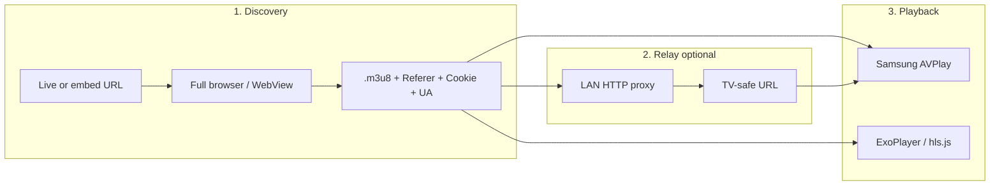

# Putting “Web Video Caster logic” into KPV

**Web Video Caster (WVC) is not open source.** You can still copy the **architecture** from OSS projects that solve the same problem: *discover a signed HLS URL + headers in a real browser, then play on the TV with AVPlay/DLNA/Cast.*

## The three layers (same as WVC, 2kit, Watchbox)

| Layer | What WVC does | What KPV has today |
|-------|----------------|-------------------|
| **1. Discovery** | Phone WebView loads page; detects HLS | **Android:** `StreamResolver.kt` (WebView + `shouldInterceptRequest` on `.m3u8`) ✅ |
| **2. Relay** | Phone proxy when TV/Cast cannot send Referer | **Android:** not needed for ExoPlayer (same headers). **Tizen:** AVPlay tries Referer; **403** may need relay ❌ |
| **3. Playback** | Tizen **WVC Receiver** or Cast LOAD | **Tizen:** AVPlay in KPV. **Android:** ExoPlayer ✅ |

Embed-first sites fail on **Tizen layer 1 inside the widget** (JW + WASM in blob iframe). WVC succeeds because **layer 1 runs on the phone**, not on the TV.

---

## Open source projects worth studying

### Closest to “give it a page → get HLS → play on TV”

| Project | License | Discovery | Relay | TV target | Notes |
|---------|---------|-----------|-------|-----------|--------|
| **[Castor](https://github.com/stupside/castor)** | OSS | `scraping-server` uses **Chrome** to extract streams | `media-server` transcodes/serves | **DLNA** (Samsung tested), Chromecast exp. | Terminal + API; good reference for **headless discovery** |
| **[origin-caster](https://github.com/tsaarni/origin-caster)** | OSS | Browser **console snippet** captures URL + headers | **Local HTTP proxy** rewrites HLS with cookies/Referer | **Chromecast / Android TV** | Best doc for **header relay** model |
| **[Watchbox-Android](https://github.com/Nicartjay/Watchbox-Android)** | OSS | Extension/site scrapers | **Local proxy** for Cast/DLNA when headers required | Chromecast + DLNA + **WVC hand-off** | Read their casting chapter — same pull + proxy pattern |
| **[FCast](https://github.com/futo-org/fcast)** | OSS | App sends stream descriptor | Protocol | Custom receivers | Open **Cast-like** protocol (mDNS) if you want phone→TV without WVC |
| **[qast](https://github.com/richlegrand/qast)** | OSS | yt-dlp / browser / direct URL | Varies | DLNA/Cast | CLI glue; `browser:` mode = headless Chromium |

### Stream URL extraction (no TV app — good for a **home resolver**)

| Project | Use for KPV |
|---------|-------------|
| **[Streamlink](https://github.com/streamlink/streamlink)** | **Site-specific plugins** (iframe → regex/API → `.m3u8`). **Won’t run JW/WASM** on these embeds without a dedicated plugin + often still needs browser cookies. Good for **LAN resolver service**: `streamlink embed-url best -O url` |
| **KPV `StreamResolver.kt`** | Already the Android discovery layer — **keep as canonical** |

### Samsung Tizen **playback only** (direct `.m3u8` URL already known)

| Project | Notes |
|---------|--------|
| **[sky-iptv-tizen](https://github.com/sanwhere/sky-iptv-tizen)** | AVPlay + transparent UI |
| **[OpenIPTV](https://github.com/shayanline/OpenIPTV)** | AVPlay + browser fallback |
| **[TVapp](https://github.com/KaashDev/TVapp)** | **hls.js** in widget (IPTV lists, not JW embeds) |
| **[Samsung SampleWebApps-PlayerAvplay](https://github.com/SamsungDForum/SampleWebApps-PlayerAvplay)** | AVPlay API sample |
| **[JuvoPlayer](https://github.com/SamsungDForum/JuvoPlayer)** | Full MIT player (heavy) |

**None of these solve embed discovery on TV** — they assume you already have a playlist URL.

### Launchers (not sniffers)

| Project | Notes |
|---------|--------|
| **[NuvioTizen](https://github.com/NuvioMedia/NuvioTizen)** | `location.replace(hosted web)` — full browser on another origin |

---

## Practical ways to merge into KPV

### Option A — **Companion mode** (removed in v1.0.43; the TV now runs the embed decoder itself)

1. **Android KPV** (already sniffs): after `StreamResolver`, expose on LAN:
   - `POST /play` `{ "url", "referer", "headers" }` or WebSocket push.
2. **Tizen KPV**: catalog on TV; on Play → **wait for companion** or show QR “Open channel on phone”.
3. TV plays with **AVPlay** + sniffed URL (same as now, but discovery on phone).

**Reuse:** existing `StreamResolver.kt` — no reverse-engineering WVC.

### Option B — **LAN resolver** (Castor / Streamlink / custom)

1. Small service on PC/NAS (could wrap **Castor `api-server`** or a **Streamlink plugin** for your site):
   - `GET /resolve?uri=<channel>` → `{ m3u8, referer, expires }`
2. **Tizen KPV** calls your LAN URL, then AVPlay.

**Reuse:** Streamlink plugin pattern ([mangomolo example](https://github.com/streamlink/streamlink/blob/master/src/streamlink/plugins/mangomolo.py): iframe → page → regex `.m3u8`). The site needs a **custom plugin** (embed URL from API → fetch embed page → may still need **headless Chrome** like Castor, not plain HTTP).

### Option C — **Header relay on phone** (origin-caster / Watchbox)

When AVPlay gets **403** from the stream CDN:

1. Phone runs **HTTP proxy** (relay segment requests with Referer).
2. TV AVPlay opens `http://phone-ip:8888/proxy/...` instead of CDN URL.

**Reuse:** [origin-caster](https://github.com/tsaarni/origin-caster) design; Watchbox Android proxy for Cast.

### Option D — **Site API** (best for one app on many TVs)

Add **`m3u8`** (or short-lived URL) to `/api/streams/{uri}` on the site.

**Reuse:** nothing — KPV already prefers API HLS + AVPlay.

### Option E — Keep improving **in-widget sniff** (current Tizen path)

Same logic as Android but **without** `shouldInterceptRequest` — blob iframe + `jwplayer().getPlaylist()`.

**Test gate:** `npm run test:sniff` on PC ([PLAYBACK.md](./PLAYBACK.md)). Fixed ad-strip bug in 1.0.19 (was deleting the whole JW bootstrap).

---

## What not to expect from OSS

- **No open-source WVC receiver** to drop into KPV — InstantBits is proprietary.
- **Streamlink generic “find any m3u8 in HTML”** was [rejected as out of scope](https://github.com/streamlink/streamlink/issues/4560) — JW/WASM pages need a browser or site plugin.
- **Tizen widget ≠ Chrome** — Tizen 6 = Chromium M76 class engine; WASM/JW may behave differently than phone.

---

## Suggested roadmap for this repo

1. **Short term:** Document WVC as external layer; fix + **PC test** for Tizen sniff (1.0.19+).
2. **Medium:** **Companion mode** Android → Tizen (small LAN API, reuse `StreamResolver`).
3. **Medium:** Optional **LAN resolver** command (Node or Castor) for power users.
4. **Long term:** site **API `m3u8`** for native TV apps.

See also [ALTERNATIVES.md](./ALTERNATIVES.md) for product-level choices.
